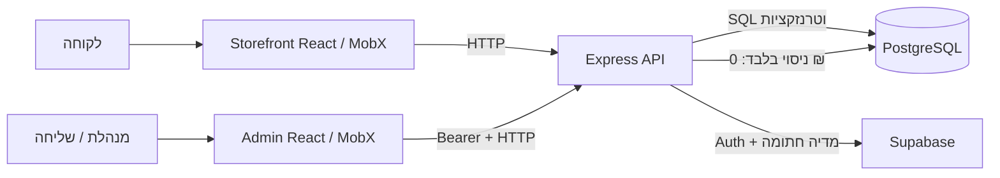

# סקירת ארכיטקטורה מערכתית — ZIS — 18.11.2026

[אינדקס](PLAN_INDEX.md) · [תוכנית המימוש](IMPLEMENTATION_PLAN.md) · [נושאים פתוחים](OPEN_ISSUES.md) · [מוכנות לפריסה](PRODUCTION_READINESS_PHASE_0.md).

**השלמת בדיקה פנימית:** [כפילויות, טוקנים, הרשאות, מבנה תיקיות ובדיקות](ARCHITECTURE_INTERNAL_REVIEW_2026-11-18.md). הסקירה הראשונית לא כיסתה נושאים אלה לעומק; הממצאים I1–I9 משלימים אותה.

## היקף ושיטת בדיקה

הסקירה הופעלה באמצעות `zis-architecture-review` על עץ העבודה המקומי ב־commit `e6f8bd6`, הכולל שינויים שטרם נרשמו ב־Git. נבדקו מבנה שלושת היישומים, שירותי ההזמנה/תשלום הניסוי/סטטוסים, לקוחות HTTP, אימות מנהל, חוזי DB, מדיה, בריאות השירות ותוכנית הפריסה. קוד ותוצאות בדיקה הם ראיה למימוש מקומי; מסמכי תוכנית אינם ראיה להפעלה חיה. לא נבדקו חשבונות, בסיס נתונים חיצוני, תעבורת Production או דפדפן, ולא הופעלה מיגרציה.

קריטריוני הסקירה: גבולות רכיבים ואחריות, מקור אמת ועקביות, הרשאות ופרטיות, התאוששות מכשל, ביצועים, תפעול ויכולת שינוי. מסגרות [AWS Well-Architected](https://docs.aws.amazon.com/wellarchitected/latest/framework/), [Azure Well-Architected](https://learn.microsoft.com/en-us/azure/well-architected/pillars), [Google Cloud Well-Architected](https://docs.cloud.google.com/architecture/framework) ו־[OWASP ASVS](https://asvs.owasp.org/) שימשו כשאלות מנחות; הן אינן מחייבות ספק ענן מסוים או מוכיחות עמידה בתקן.

## מפת המערכת כפי שהיא בקוד

שתי אפליקציות נבנות בנפרד. ה־API מרכיב נתיבים, controllers, services ו־repositories ב־[`app.ts`](../zis-api/src/app.ts#L79) וב־[`server.ts`](../zis-api/src/server.ts#L71). מחירים, זמינות ויצירת הזמנה נבדקים בשרת; יצירת הזמנה נעשית בטרנזקציה עם מפתח Idempotency ב־[`order.service.ts`](../zis-api/src/commerce/order.service.ts#L10) וב־[`postgres-order.repository.ts`](../zis-api/src/commerce/postgres-order.repository.ts#L13). תשלום ניסוי מאמת מנהלת והזמנת `is_test`, נועל הזמנה ומלאי, ורושם תשלום 0, היסטוריה ו־Audit באותה טרנזקציה ב־[`test-payment.service.ts`](../zis-api/src/commerce/test-payment.service.ts#L12). ניהול הכנה דורש `paid` ב־[`postgres-order-status.repository.ts`](../zis-api/src/operations/postgres-order-status.repository.ts#L42).

| תחום | מה אומת מקומית | מה נותר לא מאומת |
|---|---|---|
| חנות ו־Admin | שתי חבילות בנייה וקוד לקוחות נפרדים; TypeScript עבר בשניהם | Build מלא, מסכי דפדפן וחוזים מול API חי |
| API | מבנה routes/controller/service/repository, הרשאות מנהלת ו־19 בדיקות ממוקדות עברו | HTTP מלא, עומס, התנהגות מאחורי Proxy |
| נתונים ותשלום ניסוי | טרנזקציות, נעילות, גרסאות ואישור 0 ₪ בקוד; בדיקות PGlite קודמות עברו 24/24 ב־18.11 | ledger/schema, RLS ונתוני Production |
| מדיה | העלאה עם בדיקת סוג/חתימה וקישורים חתומים בקוד | הרשאות Storage וחוסן מול כשל בין העלאה למטא־נתונים |
| פריסה ותפעול | liveness/readiness לקישור PostgreSQL בקוד | Staging, Docker, CI, גיבוי/שחזור, ניטור ויעדי ביצועים |

## ממצאים מדורגים

עדכון 18.11.2026: לאחר יצירה מוצלחת מנקים רק סל שתואם לפריטים שנשלחו; רענון אישור אינו מנקה סל. 31 בדיקות חנות עברו. שחזור תוצאה לא ידועה לאחר רענון עדיין פתוח, וכך גם יתר ממצאי הסקירה; הטקסט להלן מתאר את המצב בסקירה המקורית.

### A1 — קריטי להשקת חנות משלמת: אין מסלול תשלום אמיתי

[`order.service.ts:21`](../zis-api/src/commerce/order.service.ts#L21) יוצר הזמנה ב־`ordered/pending`. המסלול היחיד בקוד שמשנה תשלום ל־`paid` הוא אישור ניסוי, והוא דוחה הזמנה רגילה ב־[`test-payment.service.ts:21`](../zis-api/src/commerce/test-payment.service.ts#L21). גם [תוכנית P6](IMPLEMENTATION_PLAN.md) עדיין דורשת Adapter לספק, Webhook מאומת, התאמת תשלום/מלאי ומסמכים. לכן הזמנה רגילה יכולה להישמר, אך אינה יכולה להגיע לתשלום מאומת ולהכנה דרך המסלול הממומש. זהו חסם מימוש ידוע, לא כשל בבדיקות הניסוי.

**כיוון תיקון ואימות:** לבחור ספק ומדיניות הכשל, להכין Adapter ו־Webhook עם מזהה פעולה עמיד, אימות סכום/מטבע/הזמנה, בירור תוצאה לא ידועה והקצאת מלאי פעם אחת; לבדוק Sandbox, כפילות, סדר אירועים, rollback והמשך לניהול. אין להפעיל חיוב חי במסגרת הסקירה.

### A2 — קריטי לתפעול: מסלול ביטול והחזרת מלאי/כסף אינו מחובר

[`order-status.service.ts:11`](../zis-api/src/operations/order-status.service.ts#L11) דוחה `cancelled` בשינוי סטטוס רגיל; [`order-correction.service.ts:16`](../zis-api/src/operations/order-correction.service.ts#L16) דוחה אותו גם בתיקון. [O09](OPEN_ISSUES.md) דורש ביטול בכל שלב עם החלטות לגבי חבילה, כסף ומלאי. לכן מנהלת אינה יכולה לסיים ביטול מלא במסלול הניהול הקיים; ניסיון לתקן סטטוס ידנית לא יבטיח החזרת מלאי או טיפול כספי עקבי.

**כיוון תיקון ואימות:** לסגור את החלטות O09, לבנות פעולה נפרדת עם נעילת הזמנה, מניעת ביטול חוזר, Audit, טיפול במלאי והפניה להחזר מאומת; לבדוק כל שלב, תחרות וכשל חלקי. אין להסיר לבדה את חסימת `cancelled`.

### A3 — גבוה: חוזה הסכמה מול בסיס הנתונים עדיין אינו מוכח בסביבה פעילה

יצירת הזמנה תלויה ב־`order_number_seq` ב־[`postgres-order.repository.ts:62`](../zis-api/src/commerce/postgres-order.repository.ts#L62); עריכת pending תלויה בטבלה נפרדת ומחזירה 503 בהיעדרה ב־[`pending-edit-requests.repository.ts:16`](../zis-api/src/commerce/pending-edit-requests.repository.ts#L16). [O08](OPEN_ISSUES.md) מתעד ledger/scheme לא מאומת ו־[O33](OPEN_ISSUES.md) מציין דיווח בעלת האתר על 019 בלי אימות עצמאי. אם שירות רץ מול סכמה חסרה או חלקית, פעולות כתיבה ייכשלו אף ש־TypeScript ובדיקות היחידה עוברים.

**כיוון תיקון ואימות:** להכין preflight קריאה בלבד לסכמה, הרשאות ו־ledger ולבדוק מול DB מבודד; בעלת התפקיד המורשית מחילה שינויים ידנית דרך תהליך DB המאושר, ואז מאמתים יצירה, retry ועריכה. אין להריץ מיגרציות אוטומטית.

### A4 — גבוה: פערי התאוששות וניקוי סל בצד הלקוח

מפתח הניסיון ליצירת הזמנה נשמר רק בזיכרון ב־[`checkout.store.ts:38`](../apps/storefront/src/features/checkout/checkout.store.ts#L38), בעוד [`checkout.recovery.ts:20`](../apps/storefront/src/features/checkout/checkout.recovery.ts#L20) שומר token רק לאחר קבלת תשובת יצירה. אם השרת שמר הזמנה והתשובה אבדה ואז הדף רוענן, אין ללקוחה מפתח ניסיון או token לשחזור ודאי. נוסף על כך, כל הצלחת `refreshConfirmation` קוראת `cartStore.clear()` ב־[`checkout.store.ts:316`](../apps/storefront/src/features/checkout/checkout.store.ts#L316), אף ש־[`PendingOrderItems.tsx:12`](../apps/storefront/src/features/checkout/PendingOrderItems.tsx#L12) משתמש בסל לתוספות להזמנה ממתינה; רענון אישור יכול למחוק תוספות שטרם נשמרו.

**כיוון תיקון ואימות:** להגביל ניקוי סל להשלמת יצירת אותה הזמנה, ולשמור תוספות בעריכת pending. להחליט עם בעלת האתר כיצד מבררים תוצאת יצירה לא ידועה ותפוגת token (כבר ב־[OWNER_ACTIONS](OWNER_ACTIONS.md)); לבדוק רענון, אובדן תשובה, כניסה חוזרת ומניעת כפילות.

### A5 — בינוני, תלוי פריסה: מגביל הבקשות הוא מקומי לתהליך ול־IP

[`rate-limit.ts:15`](../zis-api/src/middleware/rate-limit.ts#L15) מחזיק מונים ב־`Map` בזיכרון, לפי `request.ip` ב־[שורה 27](../zis-api/src/middleware/rate-limit.ts#L27). [`app.ts:84`](../zis-api/src/app.ts#L84) מפעיל אותו לפני כל הנתיבים, כולל readiness; הסף הוא 120 בקשות לדקה ב־[`constants/http.ts:4`](../zis-api/src/constants/http.ts#L4). במספר מופעי API לכל מופע מונה עצמאי, ומאחורי Proxy ללא הגדרת IP אמינה ייתכן שכמה לקוחות ייספרו יחד. זהו סיכון פריסה, לא כשל שנצפה בסביבה החיה.

**כיוון תיקון ואימות:** לקבוע טופולוגיית Proxy ומהו IP אמין, להחריג/להפריד health, להגדיר מגבלות לפי סוג נתיב וחשבון, ולבחור מונה משותף רק אם מפעילים כמה מופעים. לבדוק לקוחות שונים, Proxy, restart ו־429 בלי לחסום משתמשים תקינים.

### A6 — בינוני: העלאת מדיה ושמירת מטא־נתונים הן שתי פעולות נפרדות

[`admin-media.controller.ts:38`](../zis-api/src/controllers/admin-media.controller.ts#L38) מעלה קובץ ל־Storage ומחזיר נתיב; אחר כך [`catalog-media.store.ts:63`](../apps/admin-mobile/src/features/catalog/catalog-media.store.ts#L63) יוצר את רשומת התמונה ב־API אחר. אם שמירת המטא־נתונים נכשלת או הדפדפן נסגר אחרי ההעלאה, אובייקט Storage עלול להישאר ללא שיוך. זהו סיכון ניקוי/עלות, ללא ראיה כרגע לכמות אובייקטים יתומים.

**כיוון תיקון ואימות:** לשמור רישום העלאה זמני או מנגנון ניקוי לאובייקטים שלא קושרו, עם retry שאינו מעלה שוב; לבדוק כשל DB, יציאה מהמסך וניסיון חוזר. אין למחוק קבצים קיימים ללא מיפוי בעלות.

### A7 — סיכון אבטחה לבדיקה ייעודית: אסימון מנהלת נשמר בדפדפן

[`admin-session.store.ts:7`](../apps/admin-mobile/src/stores/admin-session.store.ts#L7) טוען Bearer token מ־`localStorage`, ו[שורה 16](../apps/admin-mobile/src/stores/admin-session.store.ts#L16) שומר אותו שם. JavaScript שרץ באותו Origin יכול לקרוא אותו; לא נמצאה בסקירה זו הוכחה ל־XSS או לניצול. השרת כן מאמת את האסימון והתפקיד בכל פעולה שנדגמה ב־[`supabase-auth.resolver.ts:19`](../zis-api/src/auth/supabase-auth.resolver.ts#L19).

**כיוון תיקון ואימות:** בסקירת אבטחה ממוקדת לבחון CSP, קלט/HTML של תוכן מנוהל, תוקף אסימון ומודל session חלופי; אם עוברים ל־Cookie, לכלול הגנת CSRF. לא לשנות מודל session בלי בדיקת זרימות הניהול.

## החלטות, מדידות ותור עבודה

1. לסגור את A1 ו־A2 לפני חנות משלמת, יחד עם הכרעות בעלת האתר על ספק, חריגי תשלום וביטול. [O25](OPEN_ISSUES.md) על תוספות משלוח נשארה החלטת מחיר נפרדת; אין להכריע לפי קוד קיים.
2. לאמת A3 מול DB בדיקה ו־preflight, ואז להקים Staging מבודד, CI, אריזת שירותים, ניטור, גיבוי ותרגיל שחזור לפי [P8](IMPLEMENTATION_PLAN.md) ו[תוכנית הפריסה](PRODUCTION_DEPLOYMENT_PLAN.md). בדיקת קבצים חוזרת לא מצאה Dockerfile/Compose/Workflow; מצב חשבונות חיצוניים לא נבדק.
3. לתקן את A4 ולבדוק שחזור דפדפן. לטפל ב־A5–A7 לפני הרחבת תנועה או פרסום הניהול. בדיקת עומס לנתיב הבית נחוצה לפני החלטת pagination/cache: [`postgres-home.repository.ts:20`](../zis-api/src/dashboard/postgres-home.repository.ts#L20) מחזיר פריטים לכל טווח התאריכים ו־[`home.service.ts:13`](../zis-api/src/dashboard/home.service.ts#L13) חותם URL לכל נתיב תמונה ייחודי; אין כרגע מדידת נפח או זמן תגובה המצדיקה דירוג כתקלה.

## בדיקות וגבולות האימות

- `npm.cmd --prefix zis-api run typecheck`, `npm.cmd --prefix apps/storefront run typecheck`, `npm.cmd --prefix apps/admin-mobile run typecheck`: שלושתן עברו.
- 19/19 בדיקות API ממוקדות עברו: יצירת הזמנה, תשלום ניסוי, סטטוסים, תיקון סטטוס, דשבורד ו־readiness. בהרצה הקודמת ב־18.11 עברו גם 24/24 בדיקות תשלום מול PGlite, ‏30/30 בדיקות חנות ו־26/26 בדיקות ניהול; אלו ראיות קוד מקומיות בלבד.
- לא הורצו HTTP מלא, דפדפן, עומס, בדיקות מול DB/Storage חיצוניים, פריסה או מיגרציות. מסמך זה אינו אישור מוכנות ל־Production או אישור אבטחה מלא.
