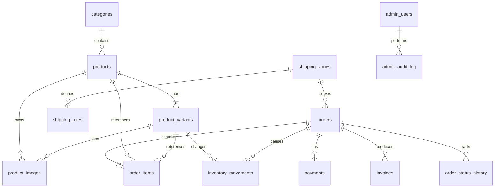

# ERD וסכמת בסיס הנתונים למערכת ZIS

## מטרת המסמך

מסמך זה מגדיר את מבנה בסיס הנתונים הראשוני עבור ZIS. מיגרציה 014 מסירה את ישות שיטות המשלוח מהיעד; המסמך אינו הוכחה שהסכמה חלה במסד או תואמת למימוש.

להשוואה בין הסכמה הזו לבין הטבלאות והצרכים המשתמעים מהאפיון, ראו [ERD_COMPARISON.md](ERD_COMPARISON.md).

המודל מתייחס למכירה לפי Set בלבד: `quantity_sets` הוא מספר ה־Sets שנרכשו, ו־`set_size` הוא מספר היחידות הפיזיות בכל Set.

## עקרונות בסיסיים

- בסיס הנתונים יהיה PostgreSQL ב־Supabase.
- לכל מוצר יש וריאציה אחת או יותר; מוצר ללא וריאציות יקבל וריאציית ברירת מחדל.
- מחיר, SKU ומלאי נשמרים ברמת הווריאציה; גודל ה־Set ומינימום ההזמנה נשמרים ברמת המוצר, משום שהם עשויים להיות שונים ממוצר למוצר.
- בשלב הנוכחי מנוהל רק מלאי של הלקוחות הפרטיים, במספר Sets זמינים.
- הזמנה שומרת Snapshot עצמאי של נתוני המוצר והמחיר בזמן הרכישה.
- כתובת נשמרת בתוך `orders.delivery_address` ככתובת יעד למשלוח בלבד; בשלב הנוכחי לא תוקם טבלת כתובות נפרדת.
- מוצרים והזמנות אינם נמחקים פיזית; משתמשים ב־Soft Delete או Archive.
- תמונות נשמרות ב־Supabase Storage, ובטבלה נשמרים הנתיב והמטא־דאטה בלבד.
- אין החזרות בשלב הנוכחי; רק משתמש Admin פעיל רשאי לבטל הזמנה, וכל ביטול נרשם ב־`admin_audit_log` וב־`order_status_history`.
- סוגי המסמכים המדויקים מול חשבונית ירוקה יוגדרו בהמשך.
- טווחי גודל, שעות ודחיפות למשלוחים יוגדרו בהמשך.
- כל הטבלאות העסקיות יכילו `created_at` ו־`updated_at` כאשר הדבר רלוונטי.

## כלל שמות מזהים

כל Primary Key יכיל את שם הישות עם הסיומת `_id`, ולא ייקרא `id` בלבד: `product_id`, `product_variant_id`, `order_id` וכן הלאה. גם Foreign Key ייקרא לפי הישות שאליה הוא מצביע; בטבלאות קישור יישמרו שמות המפתחות של שתי הישויות.

## רשימת שמות הטבלאות

### טבלאות ליבה

- `categories`
- `products`
- `product_variants`
- `product_images`

### טבלאות משלוחים והגדרות חנות

- `shipping_zones`
- `shipping_rules`
- `store_settings`
- `store_closures`

### טבלאות הזמנות ותשלום

- `orders`
- `order_items`
- `order_status_history`
- `payments`
- `invoices`

### טבלאות מלאי וניהול

- `inventory_movements`
- `admin_users`
- `admin_audit_log`

## תרשים קשרים ראשוני

## פירוט הסכמה לפי תחום

- [קטלוג, וריאציות ותמונות](schema/CATALOG.md).
- [משלוחים והגדרות חנות](schema/SHIPPING.md).
- [הזמנות, תשלום וחשבוניות](schema/ORDERS.md).
- [מלאי, מנהלים ולוג](schema/INVENTORY_ADMIN.md).
- [הרשאות, קשרים ועדכוני החלטות](schema/POLICIES_AND_UPDATES.md).
- [מודל מלאי וקיבולת — כולל טבלאות ההרחבה](INVENTORY_MODEL.md).

## מצב הסכמה — 18.09.2026

זהו מפרט תכנון מפוצל; [014](../zis-db/migrations/014_single_shipping_method.sql) מגדירה הסרת טבלת שיטות המשלוח ושמירת תווית היסטורית בהזמנות. היא טרם הוחלה, לכן התרשים לעיל מתאר את הסכמה ההיסטורית מ־001 ולא מוכיח את מצב המסד החי. אין להסיק מהתרשים שהוא כולל את כל טבלאות 003. [פערי הסכמה וההרשאות](OPEN_ISSUES.md) חייבים להיסגר לפני חיבור נתונים אמיתיים. [סדר המיגרציות](../zis-db/README.md).

[חזרה לאינדקס](PLAN_INDEX.md).
