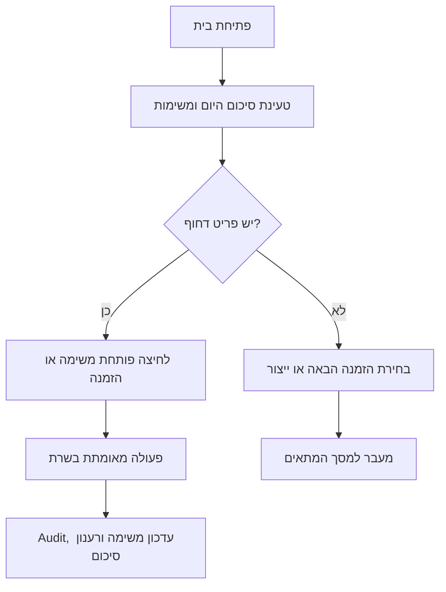
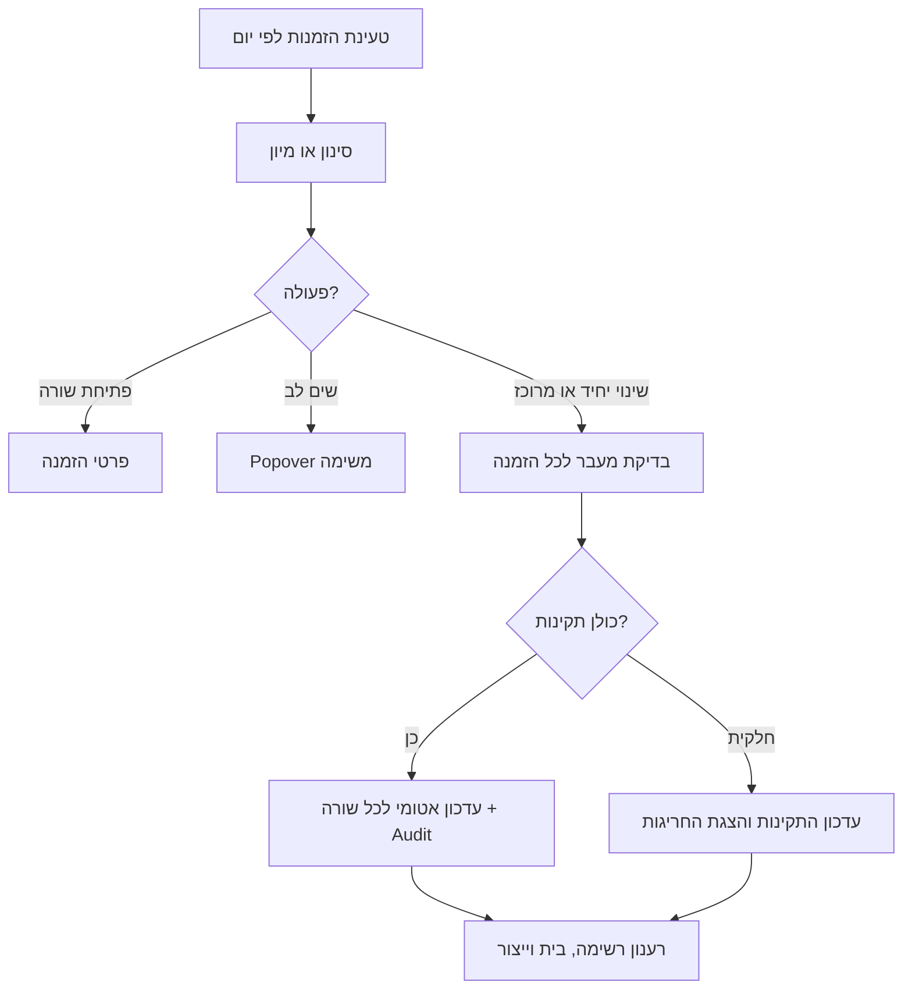
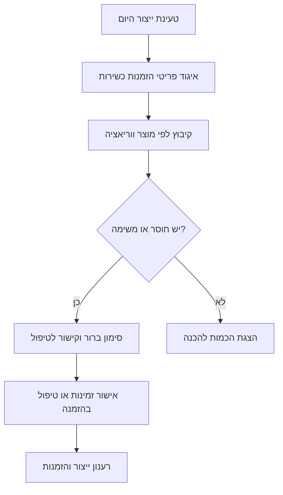

# אפיון ניהול מובייל — שלושת מסכי הליבה

[אינדקס](../PLAN_INDEX.md) · [תוכנית](../IMPLEMENTATION_PLAN.md) · [פערים](../OPEN_ISSUES.md) · [החלטות](DECISIONS.md).
עודכן בהנחיות בעלת האתר ב־24.09.2026. זהו מפרט יעד ל־P1/P5/P7; אין עדיין UI ניהול או API להזמנות.

## החלטות שתועדו

- מסך הבית הוא מסך תפעול, לא דוח מכירות: הוא מציג **את סך ההזמנות לאספקה היום** ואת חלוקתן לפי סטטוס.
- “דורש טיפול” מאחד משימות מערכת, כגון חוסר או כשל תשלום, ומשימות ידניות שמנהל מוסיף. פריט פתוח אינו נעלם אם שליחת Push נכשלה.
- פעמון ההתראות מציג את מספר ההתראות שלא נקראו. “דורש טיפול” נשאר אזור נפרד שסופר משימות פתוחות, גם אם ההתראה כבר נקראה.
- ברשימת היום מוצגות הזמנות פעילות לאותו `delivery_date`, ממוינות כברירת מחדל לפי סטטוס ואז מספר הזמנה. הזמנות שבוטלו אינן נכללות בסך הראשי; מונה ביטולים נפרד מופיע רק כאשר יש ביטול. אין חלון מסירה אישי בשלב הראשון: כל ההזמנות יוצאות בשעת יציאה קבועה שנשמרת ב־DB ומוצגת ללקוחה.
- עדכון 26.11: כרטיס הזמנה מציג סטטוס ותמונות של הפריטים שהוזמנו; עבור מארז תופיע תמונת המארז בלבד בסיכום. בפירוט יוצגו תמונות הרכיבים בהזחה בתוך מסגרת המארז. דרישה זו מחליפה את ההנחיה הישנה שכרטיס לא יציג תמונות מוצרים.
- ניסיון תשלום חוזר פותח/ממשיך ניסיון אצל ספק התשלום. רק אימות שרת מול הספק או Webhook משנה את מצב התשלום; כשל שומר את ההזמנה ואת העגלה המקומית.
- ביטול אפשרי בכל שלב. אחרי אריזה ומעבר לכך נדרשים בירור החזקה בחבילה, אישור נוסף וטיפול כספי נפרד; אין מסלול ביטול מרוכז.

## כללי פעולה משותפים

- החלטת 26.11 — בתיקון סטטוס לאחור דרך שלבי האריזה והיציאה, למשל „יצאה” → „נארזה”, „נארזה” → „בהכנה” או „נמסרה” → „יצאה”, יש לשאול במפורש האם לאפס את מספר האריזות השמור או לשמור אותו. אין ברירת מחדל ואין איפוס אוטומטי. בחירת איפוס מוחקת את הכמות השמורה, אך אינה מבטלת את מינימום האריזות לפי התכולה; הבחירה ושינוי הכמות נרשמים עם שינוי הסטטוס וה־Audit.
- כל נתון תפעולי מגיע מה־API; MobX שומר רק מצב ממשק כגון שורות מסומנות, Drawer פתוח וסינון מקומי זמני.
- שינוי סטטוס רגיל אפשרי לשורה אחת, לגרירה אל יעד סטטוס, או לפעולה מרוכזת על שורות מסומנות. השרת בודק כל הזמנה בנפרד ומחזיר הצלחה/כישלון לכל שורה.
- הפעולות המרוכזות מותרות רק במעבר קדימה: `ordered` (רק אם paid) → `in_preparation` → `packed` → `in_transit` → `delivered` → `approved`. ביטול, החזרה לאחור, חוסר ותשלום נשארים פעולה פרטנית ומתועדת.
- אייקון “שים לב” מופיע כאשר קיימת משימה פתוחה הקשורה להזמנה. לחיצה עליו פותחת את ההודעה ואת הפעולה הבאה, בלי לפתוח את כל ההזמנה.
- פרטי לקוחה רגישים אינם מופיעים ברשימת היום. במסך הפרטים מציגים רק למנהל מחובר ובעל הרשאה תקפה.

## מסך 1 — בית: מסלול היום

### מטרת המסך

לתת בתוך שניות תשובה לשלוש שאלות: כמה הזמנות יש היום, מה הפעולה הדחופה ביותר, ומה יש להכין עכשיו.

### מבנה

1. כותרת: תאריך, מצב חנות ופעמון עם מספר ההתראות שלא נקראו.
2. כרטיס “מסלול היום”: סך הזמנות היום, חלוקה לפי סטטוס ומספר שנותרו עד יציאה. זהו מדד תפעולי ולא ניקוד.
3. “דורש טיפול”: עדיפות לפי סיכון למשלוח/כסף/מלאי, ולאחר מכן משימות ידניות. משימה ידנית דורשת כותרת בלבד, ללא תאריך יעד וללא חזרתיות.
4. “הבא בתור”: שלוש עד חמש הזמנות ראשונות לפי סדר המיון הנוכחי, עם אייקון סטטוס והתראת “שים לב” אם ישנה.
5. קיצורי דרך: כל הזמנות היום, ייצור, מוצרים ומלאי.

### נתונים וחוזה יעד

`GET /admin/dashboard?date=YYYY-MM-DD` מחזיר `todayOrderCount` ללא cancelled, `cancelledOrderCount` רק כאשר קיים ביטול, ספירות סטטוס, `unreadNotificationCount`, משימות פתוחות, הזמנות הבאות וסיכום ייצור. אלה נתוני קריאה בלבד; שינוי נפרד מפעיל invalidation ורענון.

### זרימה

## מסך 2 — הזמנות היום

### מטרת המסך

לאפשר למצוא, להבין ולהעביר הזמנות במינימום לחיצות, בלי לאבד שליטה בפעולות חריגות.

### מבנה

1. כותרת “הזמנות היום” עם הספירה הכוללת ותאריך. ברירת המחדל היא היום; שינוי תאריך יוגבל למסננת תאריכים, לא יוסתר בתוך הרשימה.
   עדכון 26.11: בחירת יום אחר תסומן באופן בולט רק במסך שיש בו בחירת תאריך. לאחר 10 דקות ללא פעילות באותו מסך תופיע תזכורת עם התאריך ואפשרות להמשיך או לבדוק אותו. מעבר בין רשימת ההזמנות לפרטי הזמנה שומר על התאריך; ביציאה מאזור ההזמנות לתחום אחר התאריך חוזר להיום ומופיעה הודעת עדכון זמנית. מסלול היום מציג תמיד את היום הנוכחי.
   בכל מקום בניהול ובחנות שבו מציגים את מספר המארזים, כולל אריזה ותוויות, תוצג מתחת לשם שורה קטנה ושונה, ללא סימן כפל, שבה רק הספרה מודגשת: „**1** מארז” או „**2** מארזים זהים”. בפרטי ההזמנה הרכיבים ותמונותיהם בהזחה במסגרת משותפת; הכמות לכל מארז וסך הכול מוצגים לכל רכיב, ומחיר המארז מופיע משמאל למטה ליד הרכיב האחרון. מוצרים שנרכשו בנפרד אינם מוצגים כחלק מהמארז. דוחות תפעול יציגו את הקיבוץ בהתאם ל[תוכנית המארזים](BUNDLES_REMAINING_WORK_PLAN.md).
   במסכי אריזה, תוויות ומשלוח מספר האריזות המינימלי הוא סכום כל המארזים הפיזיים לפי כמותם, ועוד אריזה אחת לפחות כשיש מוצרים בודדים. לדוגמה, שתי יחידות ממארז אחד ויחידה ממארז שני הן שלוש אריזות; עם מוצר בודד המינימום הוא ארבע. במסך התוויות ניתן לראות ולשנות את הכמות לפני ההדפסה; הכמות נשמרת בעת המעבר ליצאה. ברירת המחדל לא תפחת מהמינימום או ממספר אריזות שכבר נשמר, והשרת ידחה כמות קטנה מהמינימום.
2. שני Dropdowns: סינון לפי סטטוס, מוצר/וריאציה ומיקום משלוח; מיון לפי סטטוס, מוצר/וריאציה, מיקום, מספר הזמנה או סכום. ניתן לבחור סינון אחד ראשי ולפתוח “מסננים נוספים” לנייד צר.
3. פס פעולה מופיע רק לאחר סימון הזמנות: מספר נבחרו, יעד סטטוס חוקי וכפתור אישור. השרת מסרב לשורות שלא עומדות בתנאי המעבר ומציג אותן בנפרד.
4. כל שורה מציגה: אייקון סטטוס עם תווית מילולית, מספר הזמנה, סכום, עיר/שכונה, וסיכום פריטים מופרד בפסיקים. הסיכום נחתך ב־ellipsis בלבד לאחר שתועד שם מוצר אחד לפחות; התיאור המלא נגיש במסך הפרטים.
5. כפתור “שים לב” מוצג כשיש משימה פתוחה. לחיצה פותחת Popover עם ההודעה והקישור לטיפול. לחיצה על גוף השורה פותחת פרטי הזמנה במסך מלא.
6. מחווה משנית: החלקה פותחת רשימת סטטוסים חוקיים. היא אינה מפעילה שינוי מיד; לחיצה על היעד מאשרת את המעבר. קיימת גם פעולה מקלדת/כפתור מלא, לכן המחווה אינה הדרך היחידה.

### מצב פרטי הזמנה

המעבר מהשורה פותח מסך מלא, לא Modal קטן: כותרת עם מספר, סטטוס, סכום ואזהרות; כל המוצרים עם תמונה, מוצר, וריאציה, Sets ומחיר; פרטי משלוח והקדשה; היסטוריית סטטוסים ומשימות; ופעולות שינוי סטטוס וביטול. כתובת מלאה ופרטי קשר מוצגים רק כאן. שינוי סטטוס רגיל מאושר מיד מול השרת; ביטול או מעבר חריג פותחים את תהליך החריגים המתועד.

### אייקוני סטטוס

| סטטוס | אייקון ותווית מוצעת |
|---|---|
| `ordered` + `paid` | קבלה · “שולמה” |
| `in_preparation` | כובע שף · “בהכנה” |
| `packed` | קופסה · “נארזה” |
| `in_transit` | רכב משלוחים · “יצאה” |
| `delivered` | סיכת מיקום · “נמסרה” |
| `approved` | סימון מלא · “נסגרה” |
| `cancelled` | עיגול מבוטל · “בוטלה” |

### נתונים וחוזה יעד

`GET /admin/orders` מקבל `deliveryDate`, `status`, `productVariantId`, `location`, `sortBy`, `sortDirection`, `page` ו־`pageSize`. התשובה מחזירה תקציר שורה, התראת־משימה בטוחה להצגה, סטטוסים מותרים בהמשך וגרסת הזמנה למניעת דריסה.

`POST /admin/orders/bulk-status` מקבל זוגות `orderId`/`version` ויעד סטטוס. הפעולה אינה כוללת `cancelled` ואינה מטפלת בתשלום או במלאי בלי ה־Workflow המתאים.

### זרימה

## מסך 3 — ייצור היום

### מטרת המסך

לתת רשימת “מה צריך לייצר”, מאוחדת מכל ההזמנות ששולמו ונמצאות בסטטוסים שעדיין דורשים הכנה. זה אינו מסך מלאי חומרי גלם.

### מבנה

1. כותרת תאריך וספירת הזמנות הכלולות בחישוב.
2. רשימת וריאציות: תמונה, שם מוצר, שם וריאציה, מספר Sets נדרש, כמה כבר הוכנו אם נרשום זאת בעתיד, וחיווי חוסר/משימה אם ישנו.
3. לחיצה על וריאציה פותחת את ההזמנות התלויות בה ואת ההקדשות הרלוונטיות. אין חשיפת כתובות במסך הייצור.
4. קיצור “אישור זמינות” מעביר למסך המלאי: מתוכנן, מאושר וזמין נשארים ערכים נפרדים.

### נתונים וחוזה יעד

`GET /admin/production?date=YYYY-MM-DD` מאגד `order_items` של הזמנות paid ופעילות לפי `product_variant_id`. הוא מחזיר תמונה, כמות Sets, מזהי הזמנות, מצב מלאי ומשימות פתוחות. אין להסיק ממנו צריכת מלאי או סימון אריזה.

### זרימה

## משימות והתראות — מודל יעד

`admin_notifications` שומר הודעות, מצב נקראה ו־Push. כדי לנהל עבודה אמיתית נדרשת ישות מתוכננת נוספת `admin_tasks`: כותרת, פירוט, מקור (`system` או `manual`), עדיפות, סטטוס (`open`, `done`, `dismissed`), קשר להזמנה אופציונלי, מי יצר ומי סגר. במשימה ידנית הכותרת היא חובה יחידה; אין חזרתיות ואין תאריך יעד בשלב הראשון. משימה מערכתית קשורה לאירוע יציב כדי שלא תיווצר כפילות בכל רענון.

## מצבי קצה ותנאי קבלה

- אין הזמנות היום: מציגים `0` והזמנה להוסיף משימה ידנית; אין גרף מלאכותי.
- Session שפג, רשימה ריקה, טעינה ושגיאת API מקבלים מסך מפורש.
- שינוי סטטוס אחרי אריזה, ביטול, חוסר ותשלום תמיד נפתח במסך פרטים עם הבקרות המתאימות; לא בפעולת החלקה או מרוכזת.
- לחיצה כפולה, שתי מנהלות ונתון שהתיישן מחזירים מצב עדכני; אין הצלחה מדומה.
- רשימה, Dropdowns, Popover ופעולת החלקה נגישים ב־RTL, במקלדת ובמסך צר של 320px.

## שאלות שנותרו לבעלת האתר

1. הוחלט לדחות חובת שעת יציאה נפרדת לכל עיר. במהדורה הנוכחית משתמשים ב־`system_defaults.dispatch_time`; `shipping_zones.dispatch_time` קיים כ־override אופציונלי שניתן לנהל.

## הרחבת תפעול מאושרת — 24.09.2026

- מסך ההזמנות נפתח תמיד היום ומקובץ לפי סטטוס. אפשר לסמן הכול או חלק ולהעביר רק לשלב הבא; מעבר חלקי מחזיר תוצאת הצלחה/כשל לכל הזמנה.
- `paid → in_preparation` פותח רשימת ייצור במסך מלא: מוצר, וריאציה, סכום Sets וסך הזמנות היום. ניתן להפיק PDF עם תאריך ולחזור לרשימת ההזמנות; הקישור לרשימת הייצור תמיד מחשב לפי זמן הכניסה, בלי גרסאות.
- `in_preparation → packed` מפיק לאחר commit PDF תוויות עם לוגו, פריטים והקדשה, ואזור קיפול ברור לפרטי אספקה: כתובת, שם אולם, איש קשר וטלפון.
- `packed → in_transit` מסונן לפי עיר ומציג מסך מלא מקובץ לפי עיר וממויין רחוב. רשימת האספקה וה־PDF כוללים מספר הזמנה, עיר, כתובת, אולם, איש קשר וזמן מעבר; ניתן לעיין גם בימים קודמים.
- משלוחן מורשה מסמן V במסך אספקה ומעביר ל־`delivered`. רק מנהל תפעול רשאי לשנות תאריך, לסגור חנות, לבטל או להחזיר החזר מלא.
- Push נפרד נשלח למנהלי תפעול על משימה חדשה ועל הזמנה חדשה (מספר, סכום ותאריך); כל סוג ניתן לכיבוי אישי בהגדרות. Push כושל לא סוגר משימה.

הפירוט המחייב, חוזי הנתונים ועצי הבדיקה נמצאים ב־[תוכנית התפעול והאספקה](OPERATIONS_DELIVERY_PLAN.md).

## גבולות

מסכי הליבה ותהליכי ה־API כאן מתועדים כמפרט יעד; חלקם קיימים בקוד וחלקם תלויים בחוזים, ב־RLS, ב־Idempotency, ב־Workflow ההזמנות ובהשלמת O01–O10/O18/O23. אין להסיק שהמיגרציות או הנתונים קיימים במסד החי לפני בדיקת ledger.
