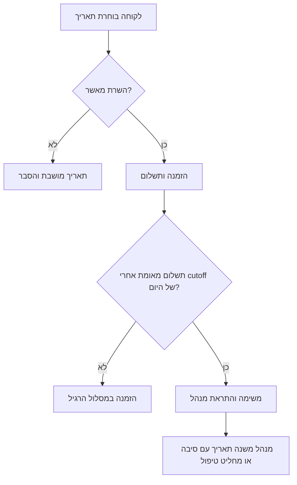
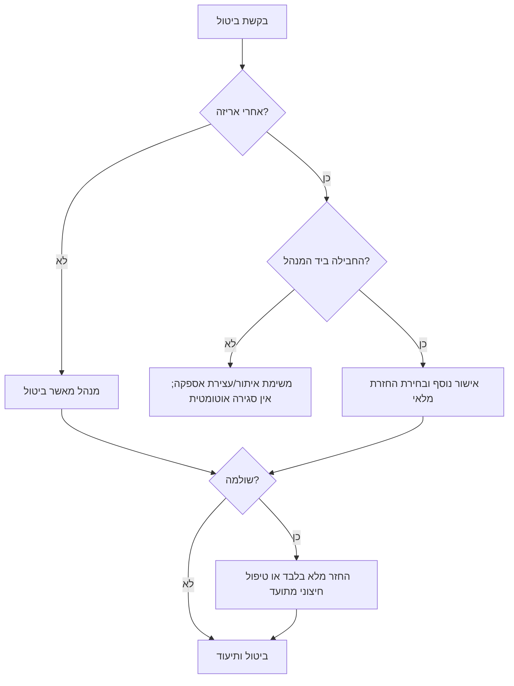

# תוכנית תפעול, אספקה ומסמכים

[אינדקס](../PLAN_INDEX.md) · [שלבי העל](../IMPLEMENTATION_PLAN.md) · [חריגים](OPERATIONS_EXCEPTIONS.md) · [פערים](../OPEN_ISSUES.md).
עודכן: 05.10.2026. זהו מפרט ותור עבודה; קוד API ומסך הגדרות קיימים, אך אין אישור להפעלה מול DB חי.

## מקור אמת והגדרות

| ערך | מקור | שימוש |
|---|---|---|
| שעת סגירת הזמנות להיום | `system_defaults.same_day_cutoff_time` | תאריך היום, הודעת לקוחה וזיהוי תשלום מאוחר |
| טווח הזמנה מראש | `system_defaults.max_advance_days` | לוח תאריכי האתר; הערך המתוכנן הוא 7 |
| אזור זמן | `system_defaults.business_timezone` | כל חישוב זמן ב־`Asia/Jerusalem` |
| זמינות עיר | `shipping_zones.is_active` | נדרש בעת הוספה/עריכה; שעת יציאה עירונית נפרדת נדחית |
| שעת יציאה | `system_defaults.dispatch_time` | שעת יציאה כללית; override אזורי אופציונלי ב־`shipping_zones.dispatch_time` |
| מחיר משלוח | `shipping_rules` | מחיר בסיס ותוספות לפי אזור, שיטה וטווח Sets |
| סגירת חנות | `store_settings.store_open`, `lock_message` | באנר בכניסה וחסימת כל "הוסף לסל" |

אין חלון מסירה אישי במהדורה זו. `delivery_date` הוא תאריך ההזמנה, ושם אולם אופציונלי נשמר ב־`orders.delivery_venue_name`.

## תאריך אספקה ותשלום

1. האתר מבקש מהשרת תאריכים מותרים. השרת חוסם עבר, תאריכים מעבר לטווח, עיר לא פעילה וסגירת חנות.
2. לאחר שעת הסגירה, תאריך היום מוחזר כלא־אפשרי. מתחת ללוח מוצג: "אנו מספקים היום הזמנות שתשלומן אושר עד [שעה]".
3. השרת מאמת שוב תאריך, מחיר, סגירות ומלאי ב־`POST /checkout/quote` וב־`POST /orders`; הדפדפן אינו סמכות. לוח חגים אינו מופעל בשלב זה.
4. Webhook מאומת שומר `payment_confirmed_at`. אם אישור תשלום להזמנה של היום הגיע אחרי שעת הסגירה, השרת יוצר פעם אחת משימה `late-paid-order:{orderId}` והתראת מנהל. הוא **לא** משנה תאריך אוטומטית.
5. מנהל תפעול בלבד רשאי לחפש מספר הזמנה, לבחור תאריך היום או תאריך עתידי תקין, להזין סיבה, ולעדכן. נשמרת היסטוריית override ו־Audit.

## סגירת חנות וקטלוג

- מסך הגדרות התפעול משנה סגירה כללית והודעה. `GET /store-status` מחזיר את הערכים לכל מסך ציבורי.
- כשהחנות סגורה, מוצג באנר כבר בכניסה; כל כפתורי "הוסף לסל" מושבתים עם הסבר. השרת גם דוחה quote ויצירת הזמנה.
- מסך הקטלוג מאפשר: בחירת מוצר קיים או יצירת חדש, שם מוצר, תיאור, שם וריאציה, מחיר/מלאי וטעינת תמונות. תמונה יכולה להיות של מוצר או של וריאציה.
- מתחת להעלאה יוצגו מידות הקובץ בפועל ותצוגת חיתוך. יחס פיקסלים מחייב נדחה; אין חסימת העלאה לפי יחס במהדורה זו.
- חוסר וזמינות מנוהלים **רק לפי וריאציה**. אין העברת מלאי או החלפה אוטומטית בין וריאציות.

## התראות והרשאות

| אירוע | למי | תוכן Push | ביטול בהגדרות |
|---|---|---|---|
| משימה חדשה הדורשת טיפול | כל מנהלי התפעול הפעילים | כותרת וקישור למשימה | `push_action_required_enabled` |
| הזמנה חדשה ששולמה | כל מנהלי התפעול הפעילים | מספר, סכום ותאריך אספקה | `push_new_order_enabled` |

Push נכשל אינו מוחק התראה או משימה. מנהל תפעול (`operations_manager`) מנהל סגירה, override, ביטול והחזר; משלוחן (`delivery_driver`) רואה רשימת אספקה יומית משותפת ומסמן "סופק" בלבד. שיוך מסלולים למספר משלוחנים נדחה. ההרשאה נבדקת בשרת, לא רק בהסתרת כפתור.

## מסך ההזמנות ומעברי סטטוס

המסך נפתח אוטומטית על היום ומחולק לקבוצות סטטוס. אפשר לסנן עיר, סטטוס, מוצר/וריאציה ולמיין; אפשר לבחור הכול או שורות מסוימות ולהעביר רק לשלב הבא. הפעולה בודקת כל הזמנה ומדווחת הצלחות וכישלונות בנפרד.

| מעבר | תוצאה תפעולית |
|---|---|
| `ordered`+`paid` → `in_preparation` | מסך מלא של רשימת ייצור: מוצר/וריאציה, סכום Sets וסך הזמנות היום; PDF עם תאריך; קישור קבוע לרשימה שמתעדכנת לפי רגע הכניסה |
| `in_preparation` → `packed` | בחירת הכול/חלק; אחרי commit מפיקים PDF תווית לכל הזמנה עם לוגו, פריטים והקדשה, ואזור קיפול ברור: אספקה, אולם, איש קשר וטלפון |
| `packed` → `in_transit` | סינון עיר ובחירת הכול/חלק; מסך מלא של רשימת אספקות המקובצת לעיר וממוינת רחוב, עם מספר הזמנה, עיר, כתובת, אולם, איש קשר וזמן המעבר; PDF להדפסה |
| `in_transit` → `delivered` | המשלוחן מסמן V ברשימת האספקות; נשמר מי ומתי ביצע |

מסכי ייצור אינם נשמרים כגרסאות: הם מחושבים מנקודת הזמן שבה נכנסים. רשימות אספקה של היום וימים קודמים נגזרות מהיסטוריית סטטוסים ומציגות את זמן המעבר; הדפסה מייצרת PDF מחדש ומוסיפה רישום Audit.

## ביטול ושינויים אחרי תשלום

- אחרי תשלום אין עריכת פריטים, כתובת או סכום בתוך המערכת. הפרשים מטופלים מחוץ למערכת, במזומן או בהסכמה אחרת; אין חיוב/זיכוי חלקי.
- ביטול הוא החריג היחיד. רק מנהל תפעול מבטל, ובמערכת יש תמיכה להחזר **מלא בלבד** לאחר חיבור הסליקה.
- אם ההזמנה הייתה אי פעם `packed` או מעבר לכך: מנהל מאשר שהחבילה בידו, מאשר ביטול פעם נוספת ובוחר אם להחזיר מלאי. ללא אישור שהחבילה בידו אין השלמת ביטול אוטומטית.
- החזרה למלאי היא לפי וריאציה, רק פעם אחת, ורק אם נבחרה מפורשות. הכסף והמלאי מתועדים בנפרד.

## סדר עבודה מחייב

1. **לבדוק היסטוריית מיגרציות וגיבוי** — [O08](../OPEN_ISSUES.md); לא לשכתב מיגרציה שכבר רצה.
2. **לאמת ולהחיל קדימה את 006–008 בפיתוח** — [006](../../zis-db/migrations/006_operations_delivery_and_admin.sql), [008](../../zis-db/migrations/008_admin_commerce_settings.sql), RLS, Seeds לערים, מחירי משלוח ושעת יציאה בפועל.
3. **לבנות מנוע זמינות תאריכים** — cutoff, עיר, סגירה ו־API חוזי [C08–C10](STOREFRONT_REQUIREMENTS.md); לוח חגים יישקל בהמשך.
4. **לבנות checkout/payment state** — idempotency, `payment_confirmed_at`, משימת תשלום מאוחר; ספק הסליקה נשאר לשלב P6 האחרון.
5. **לבנות Admin catalog/settings/notifications** — העלאות, FAQ, סגירה, ערים, העדפות Push והרשאות.
6. **לבנות orders/production/packing/delivery** — סטטוסים, PDFs, היסטוריה, מסך משלוחן וביטולים.
7. **בדיקות קצה ו־staging** — כל עץ להלן, הרשאות, הדפסה, Push, גיבוי/שחזור ואימות תשלום.

## עצי בדיקה שחובה לשמר

| מזהה | Given / When / Then |
|---|---|
| T01 | תאריך עבר, מעבר לטווח או סגירה פעילה → מושבת גם באתר וגם בשרת |
| T02 | היום לפני cutoff → זמין; באותה שנייה ואחריה → מושבת; timezone ישראלי |
| T03 | webhook מאומת אחרי cutoff להזמנת היום → משימה אחת + Push; אין שינוי תאריך אוטומטי |
| T04 | override לפי מספר הזמנה → סיבה, משתמש ותאריך קודם/חדש נשמרים; תאריך יעד עובר validation |
| T05 | סגירת חנות → באנר, כל הוספה לסל מושבתת, quote/order נדחים בשרת |
| T06 | יצירת אזור חדש דורשת מחיר משלוח בסיסי באותה שמירה; תוספות לפי כמות יורשות את כללי ירושלים, וחסר פירושו 0. אזור ללא כלל מחיר פעיל לא מאפשר Quote/הזמנה; זמינות תאריכים ומלאי אינן תלויות באזור. שעת יציאה כללית קיימת או override אזורי, והעריכה מתועדת |
| T07 | מעבר paid להכנה → סיכום וריאציות נכון ו־PDF עם תאריך; רענון מאוחר משנה את הרשימה |
| T08 | אריזה/אספקה חלקיות → רק הנבחרות משנות סטטוס; PDF מציג אולם, איש קשר וזמן מעבר נכונים |
| T09 | משלוחן מורשה מסמן סופק → רק הזמנה ברשימתו משתנה ונרשמת היסטוריה |
| T10 | ביטול אחרי אריזה ללא "בידי" → לא מושלם; עם "בידי" נדרשים אישור ובחירת מלאי; אין החזר חלקי |
| T11 | Push כבוי למשתמש אחד → אין Push אליו אך התראה/משימה נראות; Push כושל נשאר פתוח |
| T12 | שתי פעולות/Retry/webhook כפול → אין מלאי, תשלום, משימה או החזר כפולים |

## שאלות שחוסמות פרט מימוש

1. שעת יציאה נפרדת לכל עיר, יחס תמונה מחייב ושיוך מסלולים למספר משלוחנים — נדחו ואינם מטופלים במהדורה הנוכחית.
2. נקבע שהנוסח הוא "הזמנות שתשלומן אושר עד [שעה]".
3. נקבע ש־Push על הזמנה חדשה נשלח רק לאחר תשלום מאומת.

ספק הסליקה, חשבונות וסביבות הפעלה נשארו בכוונה לסוף P6/P8. אין להפעיל תשלום אמיתי לפני Sandbox, reconciliation והחזר מלא שנבדקו.
